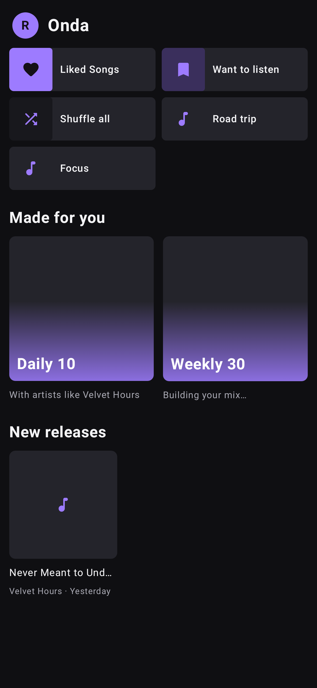
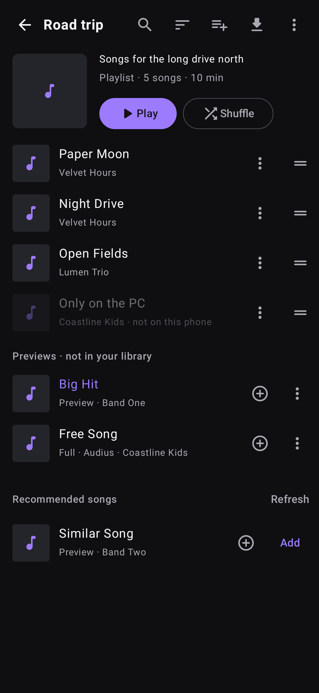
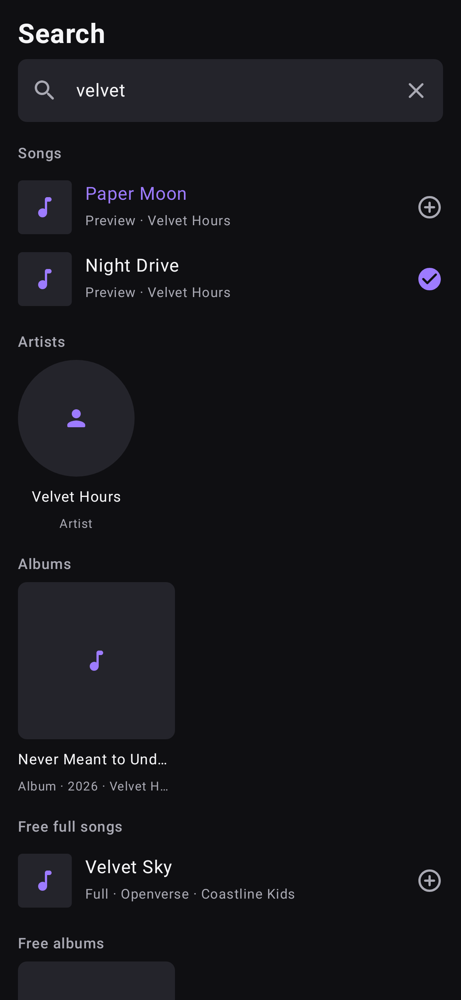

# Onda

A Spotify-style music player for Android (built for GrapheneOS) that needs no account, sends no tracking data and contains no Google code.

Onda is offline-first: it plays music you own or can legally stream, and works fully offline with your own files.

  
  
  

## What it does
- **Your music:** local folders (Storage Access Framework, no storage permission) and your own Navidrome / OpenSubsonic server, including its playlists ([setup note](docs/navidrome.md)).
- **Free full songs:** Audius, Jamendo, Openverse (Creative Commons: Wikimedia, ccMixter) and the Internet Archive (netlabels and the Live Music Archive). A Deezer preview plays as a free full copy when the artist's own account has one.
- **Discover:** search the Deezer and Apple catalogs with 30-second previews, artist and album pages, a "Want to listen" list, Daily 10 and Weekly 30 mixes (similar artists from Deezer and ListenBrainz), similar songs when the queue ends, and new-release notifications for your artists.
- **Library:** playlists (rename, drag to reorder), Liked Songs, followed artists, saved albums, "not interested", metadata matching, synced lyrics (LRCLIB), renaming files from tags, backup and restore.
- **Filters:** remixes, sped-up/slowed, live, karaoke and AI-generated "artists" are kept out of discovery. The AI list comes from [spotify-ai-blocker](https://github.com/CennoxX/spotify-ai-blocker) (MIT), and you can mark more artists yourself.
- **Spotify import:** playlists, liked songs and recent listening history from Spotify's data export or Exportify CSVs.
- **Downloads:** saved as real music files in your music folder, only from sources that allow it (your server, free catalogs).
- **Android Auto:** playlists, albums, artists, search and voice.
- **Phone and PC:** pair the phone with Onda on your Linux PC once (a 6-digit code). Playlists (with folders and cover photos), likes, Want to listen, follows, history and edited details stay in sync within seconds while both are open. Songs only on one device show greyed out and can be streamed or copied over. "Play on…" moves music between them, and the phone becomes a remote for the PC (player bar, lock screen). Over your home Wi-Fi only, end-to-end encrypted (AES-256-GCM), no cloud.

## Linux
A desktop version for Linux lives in `desktop/` (Compose for Desktop, GStreamer for playback) with the same features and design as the phone: your music folders and Navidrome server, catalog search with previews and free full songs, mixes, new releases, lyrics, metadata editing, loudness normalisation, crossfade, an equalizer, downloads, Spotify import, backups, the phone link and your desktop's media controls (MPRIS). Build it with `./gradlew :desktop:createDistributable`; `desktop/packaging/install.sh` adds it to your app menu without root.

## Privacy
- No account, no analytics, no crash reporting, no device ID. Your history never leaves your devices (the phone and, if you link them, your own PC).
- Online services (Deezer, Apple, Audius, Jamendo, Openverse, Internet Archive, ListenBrainz/MusicBrainz, LRCLIB) only see search words, song names and your IP address, and each can be turned off. Deny Onda's Network permission and it keeps working offline.
- Your server password is never stored, only a salted token.
- No Google Play Services, Firebase or ML Kit. Every build is checked for them.

## What Onda will not do
No downloading or decoding YouTube, no ripping paid services, no bypassing paid features. Previews stay previews.

## Install
1. Download the APK from [Releases](https://github.com/RealKHFan/Onda/releases).
2. Check it's really Onda: the signing certificate's SHA-256 is
   `43:E9:13:3E:A4:90:D3:3B:49:5C:0D:DD:47:6D:B2:18:96:5D:1E:38:7D:26:CB:7E:EC:D4:89:8D:C2:61:29:39`
   (`apksigner verify --print-certs onda-<version>.apk`, or AppVerifier on the phone).
3. Install it. On GrapheneOS, Onda's Network permission may need switching on in its app info.

Android 8.0 or newer. For Android Auto, enable "Unknown sources" in Android Auto's developer settings, since Onda doesn't come from the Play Store.

## License
GPL-3.0, see [LICENSE](LICENSE). The bundled AI artist list is MIT-licensed, see `app/src/main/assets/ai_artists_LICENSE.txt`.
